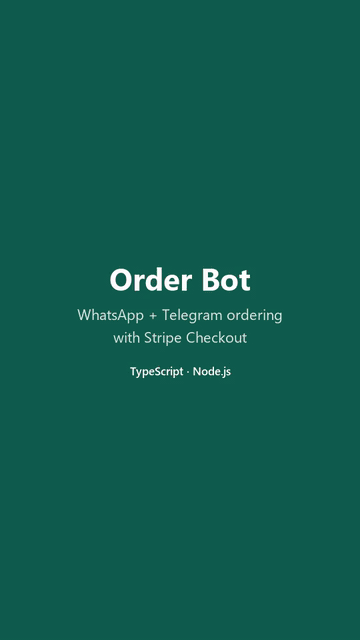

# Order Bot: WhatsApp + Telegram ordering with Stripe Checkout

[](https://github.com/ayofital/whatsapp-order-bot/actions/workflows/ci.yml)
 

A TypeScript/Node.js chatbot that lets a small business take orders in chat:

- answers common questions (opening hours, delivery, allergens, payment)
- shows the menu and builds a basket (add items, change your mind, cancel)
- collects the customer's name and delivery address
- sends a **Stripe Checkout** link and tells the customer when payment lands
- keeps every order in a JSON file, with a token-protected `/orders` endpoint for the owner

It runs on **WhatsApp Cloud API** and **Telegram**, and in your **terminal** with no accounts at all.

<p align="center">
  
  <br>
  <sub>Every bot reply in this demo comes from the real conversation engine. <a href="docs/demo.mp4">Watch as MP4</a> (74 s).</sub>
</p>

## Try it in 30 seconds (no accounts needed)

```bash
npm install
npm run chat
```

Type like a customer: `hi`, `when are you open?`, `menu`, `2`, `2`, `Checkout` ... Type `/paid` to fake a payment, `/quit` to leave.

## Run it for real

1. `cp .env.example .env` and fill in the parts you need (each section is optional).
2. `npm run dev` (auto-reload) or `npm run build && npm start`.

| Part | What to set | Notes |
|---|---|---|
| Telegram | `TELEGRAM_BOT_TOKEN` (from @BotFather) | `TELEGRAM_MODE=polling` works on a laptop. Use `webhook` + `PUBLIC_URL` in production. |
| WhatsApp | `WHATSAPP_TOKEN`, `WHATSAPP_PHONE_NUMBER_ID`, `WHATSAPP_VERIFY_TOKEN`, `WHATSAPP_APP_SECRET` | Webhook URL: `<PUBLIC_URL>/whatsapp/webhook`, subscribe to `messages`. Needs a public HTTPS URL (ngrok works for testing). |
| Stripe | `STRIPE_SECRET_KEY` (`sk_test_...`), `STRIPE_WEBHOOK_SECRET` | Webhook URL: `<PUBLIC_URL>/stripe/webhook`, event `checkout.session.completed`. Without a key, the bot sends mock links that mark the order paid when opened. |
| Admin | `ADMIN_TOKEN` | `curl -H "x-admin-token: <token>" <PUBLIC_URL>/orders` |

To adapt it for a client, edit `data/catalog.json`: business name, currency (`GBP`, `USD`, `EUR`, ...), delivery fee, products and FAQ answers. Write prices the normal way (`5.5` = £5.50).

## How it's built

```
src/
  engine.ts          conversation state machine (channel-agnostic, fully unit-tested)
  catalog.ts         menu/FAQ loading and validation, money formatting
  store.ts           OrderStore interface + JSON-file implementation (atomic writes)
  payments.ts        Stripe Checkout (plain HTTPS, no SDK), webhook signature check, mock provider
  channels/
    whatsapp.ts      Cloud API sender, webhook parser, X-Hub-Signature-256 check
    telegram.ts      Bot API sender, long polling and webhook support
  app.ts             Express routes: webhooks, payment pages, /orders
  main.ts            wiring from environment variables
  cli.ts             terminal demo
```

Design decisions worth mentioning to a client:

- **Payments are verified, not trusted.** Stripe and Meta webhooks are checked with HMAC signatures over the raw body, Stripe events older than 5 minutes are refused, and the paid amount and currency must match the order before it is marked paid.
- **No double charges or double messages.** Checkout Sessions use an idempotency key per order, and an order is marked paid (and the customer notified) only once, even if Stripe retries the webhook.
- **Messages from one customer are processed in order**, even when webhooks arrive at the same time.
- **Webhooks answer immediately** and do the work in the background, so WhatsApp and Telegram don't retry.
- **Money is handled in integer minor units** (pence/cents) everywhere.
- **Swappable storage:** implement `OrderStore` with Postgres when the business needs more than one server.

Limits: sessions (half-finished baskets) live in memory and reset on restart; currencies are assumed to have 2 decimal places.

## Scripts

| Command | What it does |
|---|---|
| `npm run chat` | terminal demo |
| `npm run dev` | server with auto-reload |
| `npm test` | 27 tests: conversation flow, Stripe/Meta signatures, webhooks end to end, storage |
| `npm run typecheck` | strict TypeScript check |
| `npm run build` / `npm start` | compile to `dist/` and run |

## Want this for your business?

I set this up for cafés, bakeries, restaurants, salons and other small businesses that take orders by chat: your menu, your answers, your Stripe account, on WhatsApp or Telegram. I can also build custom Node.js/TypeScript integrations (payments, CRMs, spreadsheets, webhooks).

**Contact:** open an issue on this repo or message me on GitHub ([@ayofital](https://github.com/ayofital)).
